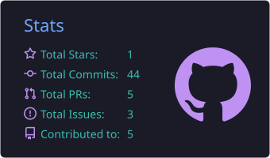
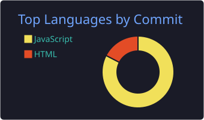

  

## 💫 Sobre mim

<table>
<tr>
<td width="60%">

### 👨‍💻 Desenvolvedor em formação

Estudante de Sistemas de Informação, com foco em desenvolvimento web, banco de dados e automação de processos. Trabalho com infraestrutura corporativa e uso essa experiência para criar soluções que economizam tempo.

🚀 **Atualmente:** aprofundando Python, SQL e IA, e buscando oportunidades para crescer na área e, no futuro, atuar internacionalmente.

</td>
<td width="40%" align="center">
  
</td>
</tr>
</table>

## 🌐 Redes

  
  
  

## 💻 Tecnologias

## 📌 Projetos em destaque

<table>
<tr>
<td><a href="https://github.com/KaioAmim/TeachLi"><b>TeachLi</b></a> Inclusão de alunos surdos em sala de aula React • Vite</td>
<td><a href="LINK_REPO_2"><b>Nome do projeto 2</b></a> Uma frase sobre o que resolve Python</td>
<td><a href="LINK_REPO_3"><b>Nome do projeto 3</b></a> Uma frase sobre o que resolve PowerShell</td>
</tr>
</table>

## 📊 GitHub Stats

  
  

  

